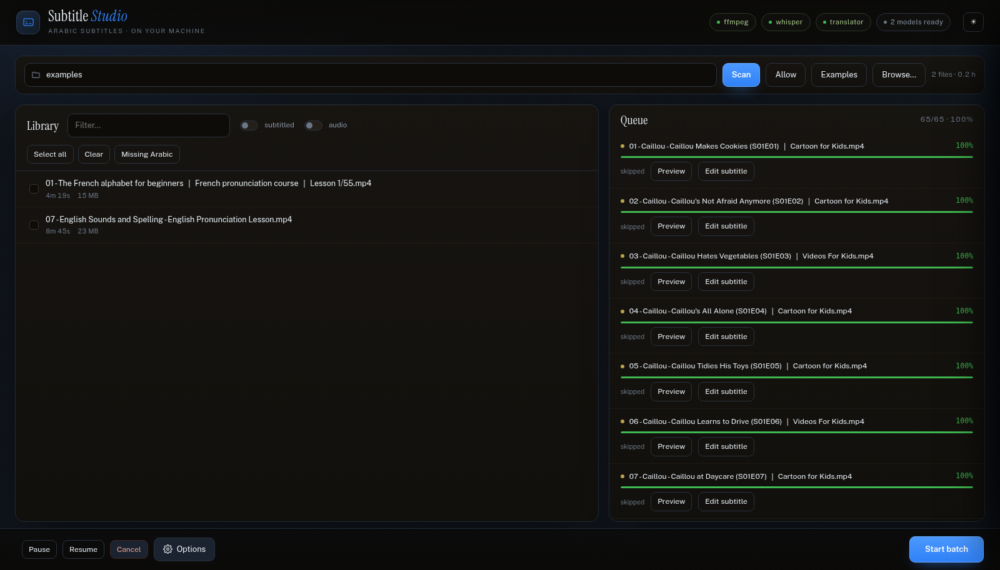
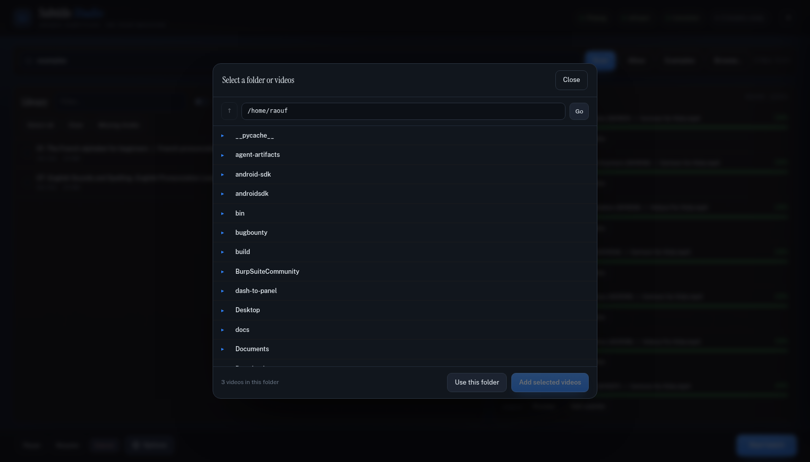
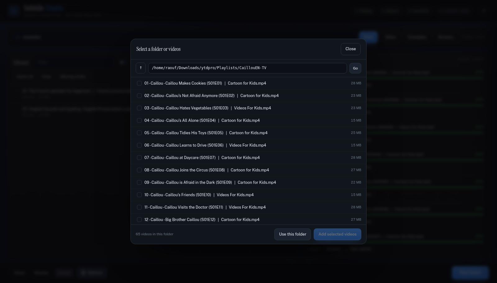
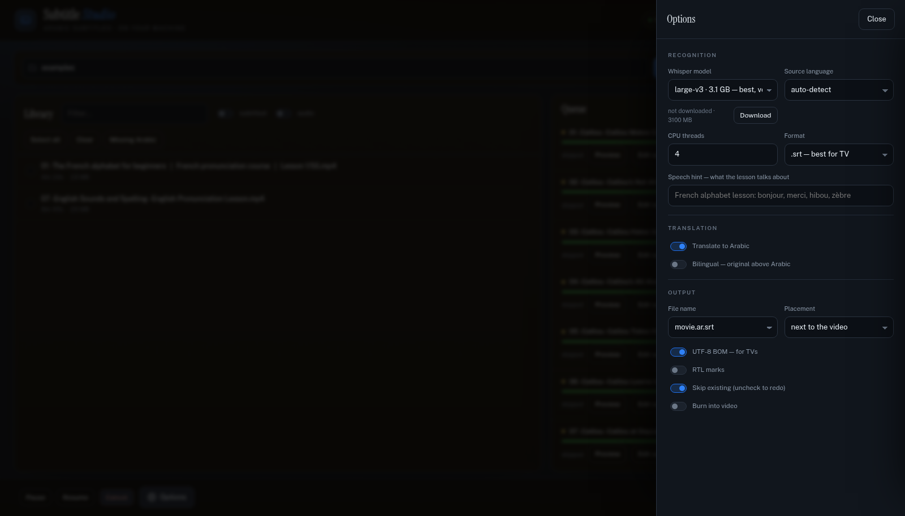

# Arabic Subtitles — batch builder

Generate Arabic `.srt`/`.ass` subtitles for a folder of videos, locally, free,
fully offline after the first model download. Optimised for putting a sidecar
subtitle **next to the video file** so a TV's built-in player picks it up.

Runs on CPU. No API keys, no cloud, no account.



---

## Quick start

```bash
./run.sh                      # opens http://127.0.0.1:8099
```

Then in the browser:

1. **Browse…** → pick a folder, or tick individual videos → **Add selected videos**
   (or type a path and press **Scan**)
2. Tick videos (or **Select files missing Arabic**)
3. Pick model / format / options → **Start batch**
4. Watch the queue; click a finished file to preview the subtitle

Headless equivalent:

```bash
. .venv/bin/activate
python cli.py /path/to/folder --model small --bilingual
```

---

## What it does

```
video ──► Whisper (ASR) ──► MarianMT (translate) ──► cue splitting ──► .ar.srt
              │                    │                      │
        speech → text        en/fr → ar          TV-sized lines,
        + timestamps        (fr chains via en)     original kept for bilingual
```

- **ASR**: `faster-whisper`, int8 on CPU. `tiny` / `base` / `small` only —
  `small` is the largest model under 500 MB.
- **Translation**: MarianMT (`opus-mt-en-ar`, `opus-mt-fr-en`). French goes
  fr→en→ar because no fr→ar Marian model is published; each hop is a separate
  ~300 MB download.
- **Splitting**: whole sentences are translated *first*, then split to fit two
  lines — translating fragments produces broken Arabic.

## Speech hinting (words Whisper should expect)

Whisper mishears unfamiliar vocabulary: in an English lesson about French it
wrote `un ibou` instead of `un hibou`, `un yaut` instead of `un yaourt`.

There is one input for that — a **Speech hint**, a sentence describing what the
lesson talks about:

`French alphabet lesson: bonjour, merci, hibou, xylophone, zèbre`

Its words are passed to the recogniser as hotwords.

Measured on a French-letter clip:

| | result |
|---|---|
| no hint | `d une dent e le f une fête … h un ibou` |
| with hint | `d, une dent, e, le, f, une fête … h, un hibou` |

Because hinting makes Whisper merge segments into 20-second blocks, cues are
rebuilt from **word-level timestamps** — each cue is capped at ~6 s or a
sentence end, so the letters stay individually synced.

## Preview

Click a finished file in the queue (or its **Preview** button) to open a player
over the app. The Arabic line is shown **live, synced to playback** — scrub the
video and the matching cue follows.

## Editing a subtitle

Every finished file gets an **Edit subtitle** button in the queue. The drawer
lists each cue with its time range and text:

- **click a line** to play that scene in the built-in player, then rewrite it
- every cue has a **▶ play** button; playback stops at the cue end
- **Replay cue** re-hears the line you are editing
- adjust `start` / `end` per line
- **shift** all cues by ±seconds if the whole file drifts on your TV
- **Save** writes back to the same `.srt`, keeping the BOM (`Ctrl+S` also saves)

Progress is shown per video and for the whole batch: `2/5 · 46% · 9m left`,
with the percentage beside each file in the queue.

## Output

Default: `subtitles next to the video`, named `movie.ar.srt`.

| Option | Effect |
|---|---|
| `movie.ar.srt` | language-suffixed; most TVs/Plex/Kodi prefer this |
| `movie.srt` | plain name; safest for very basic players |
| UTF-8 BOM | **on by default** — many TVs need it to render Arabic |
| RTL marks | wraps each line in U+202B/U+202C for old players |
| Bilingual | original line above the Arabic line |
| `.ass` | styled subtitles, better font control |

TV notes:
- Put the `.srt` in the **same folder**, same base name as the video.
- If Arabic shows as boxes, the TV lacks an Arabic font — use **burn-in**
  instead (re-encodes the video with subtitles drawn in).
- If Arabic shows backwards, try toggling **RTL marks**.

## Performance on this machine

Measured, Intel i5-7300U (2 cores / 4 threads), `small`, int8:

| stage | measured |
|---|---|
| Whisper `small` | 4 min 19 s of audio in ~90 s → **~2.9× realtime** |
| Translation (Marian, beam 2) | ~1.5 s per segment |
| Model load | ~2 s Whisper, ~15 s first translation model |

For the 56 h on the USB drive: **roughly 20–30 h of compute**. Run it
overnight in chunks; the queue is resumable and skips finished files.

Rule of thumb per 10 minutes of video: ~3.5 min to transcribe + ~1 min to
translate on this CPU.

## Resumability

- Finished files are skipped on re-run (`Skip existing`).
- Job state persists in `state/state.json`.
- Pause / Resume / Cancel from the UI; failed items can be retried.
- **Cancel stops within a second or two** (checked between speech segments and
  translation batches) and frees the worker immediately, so the next job starts
  right away instead of waiting behind the cancelled one.

## Layout

```
app/core.py      ASR, translation, SRT/ASS writers, splitting, cleanup
app/jobs.py      persisted queue + worker thread
app/server.py    FastAPI routes, SSE progress, path sandbox
app/static/      UI (vanilla JS, no build step)
cli.py           headless batch
examples/        sample videos
models/          Whisper + translation weights (git-ignored, re-downloadable)
state/           job state
output/          fallback output when a folder is not writable
```

## Troubleshooting

**`Temporary failure in name resolution` while requesting huggingface.co**
A DNS/network error: the library probes the Hub for optional metadata even
when the model is already cached. Models are now loaded with
`local_files_only=True` first, so a cached model never touches the network.
If it appears, the model being loaded is not cached yet — connect once.

**Models already downloaded?** `models/hf/hub/` holds them:

| model | size | used for |
|---|---|---|
| `models--Systran--faster-whisper-small` | ~480 MB | speech recognition |
| `models--Helsinki-NLP--opus-mt-en-ar` | ~590 MB | English → Arabic |
| `models--Helsinki-NLP--opus-mt-fr-en` | ~290 MB | French → English (then ar) |

**Nothing runs after a restart** — the queue resumes automatically at startup.

## Limitations

- CPU-only here, so `small` is the quality ceiling. A GPU would allow
  `large-v3`, which is noticeably better for Arabic.
- MarianMT is a small statistical model: expect occasional mistranslations
  (idioms, proper nouns). Numbers and technical terms are usually fine.
- Subtitles are a best-effort machine translation — review anything published.

## Screenshots

| | |
|---|---|
|  |  |
| Folder picker |  |
| Pick individual videos |  |
| Preview |  |
| Model manager |  |

## License

**Free for personal and educational use. Businesses need a paid licence.**

Subtitle Studio is licensed under the
[PolyForm Noncommercial License 1.0.0](LICENSE).

| Use | Licence |
|---|---|
| Personal projects, hobby, private use | Free |
| Study, research, experimentation | Free |
| Schools, universities, non-profit education | Free |
| Charities, public bodies, government | Free |
| **Any commercial or business use** | **[Paid licence](COMMERCIAL.md)** |

Commercial use includes internal use by a company, client work, paid products
and hosted services. See [COMMERCIAL.md](COMMERCIAL.md) for terms and contact.

> Note: this is a source-available licence, not an OSI open-source licence.
> GitHub will show it as “Other”.
