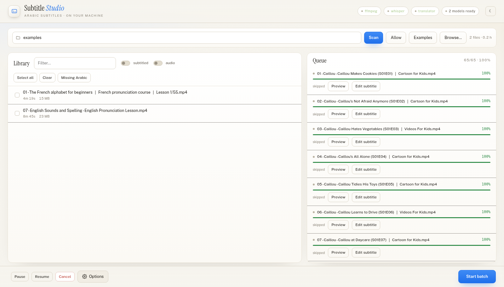
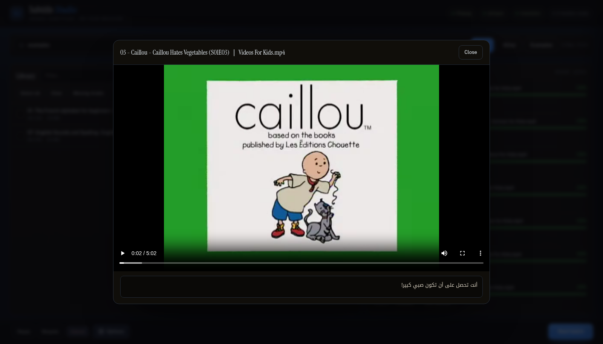
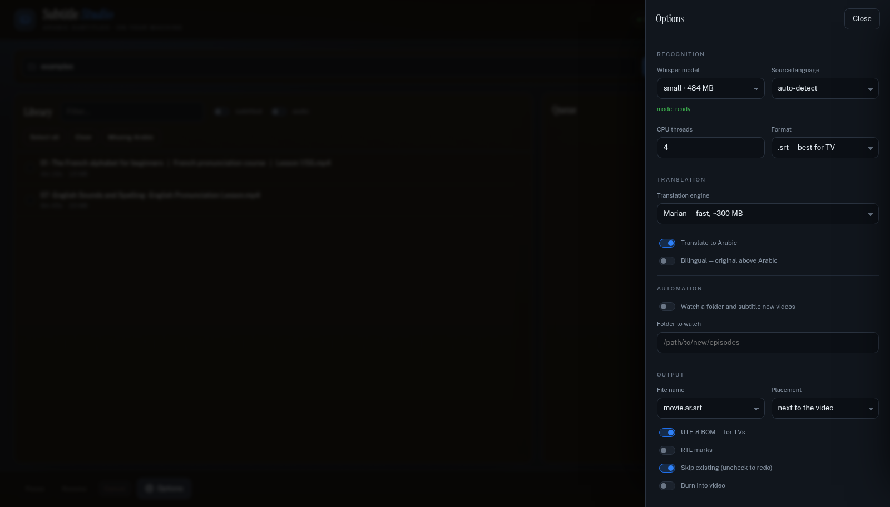
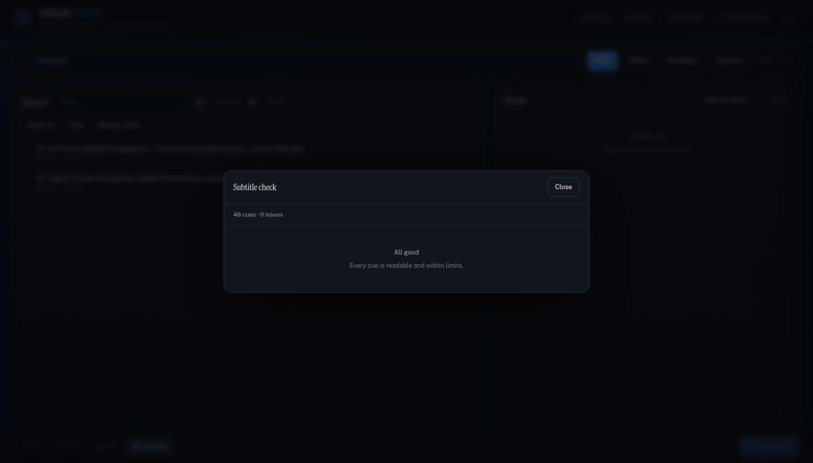

# Arabic Subtitles — batch builder

Generate Arabic `.srt`/`.ass` subtitles for a folder of videos, locally, free,
fully offline after the first model download. Optimised for putting a sidecar
subtitle **next to the video file** so a TV's built-in player picks it up.

Runs on CPU. No API keys, no cloud, no account.


---

## Install

Requirements: **Python 3.10+** and **ffmpeg** on your PATH. Everything else is
installed by the setup script into a local `.venv`.

### Windows

1. Install **Python 3.10+** from [python.org](https://www.python.org/downloads/)
   — tick **“Add python.exe to PATH”** during installation.
2. Install ffmpeg — open PowerShell and run:
   ```powershell
   winget install Gyan.FFmpeg
   ```
   then close and reopen the terminal so PATH refreshes.
3. Download the project (Code → Download ZIP, or `git clone`), open the folder
   and **double-click `run.bat`**.

The first run installs the dependencies (a few minutes), then opens
`http://127.0.0.1:8099`. To reuse it later, just double-click `run.bat` again.

From a terminal instead:

```bat
setup.bat        :: one-time install, run it first
run.bat          :: start the app
```

> The window stays open on errors so you can read them.
> Windows may warn about an unknown script the first time — it is a plain
> `.bat` file you can open in Notepad.

### Linux / macOS

```bash
git clone https://github.com/ethicalvulnlab/subtitle-studio.git
cd subtitle-studio
./run.sh            # sets itself up on first run
```

macOS needs ffmpeg from Homebrew: `brew install ffmpeg`.
Debian/Ubuntu: `sudo apt install ffmpeg`.

### What the setup does

`bootstrap.py` (used by both `run.sh`/`run.bat` and `setup.sh`/`setup.bat`):

- creates `.venv` next to the code
- installs `requirements.txt` plus the **CPU build of torch**
- creates `models/`, `state/`, `output/`, `examples/`
- checks that `ffmpeg` can be found and explains how to install it if not

Nothing is installed system-wide, and deleting `.venv` undoes everything.

## Models — where they live

**You do not download or place model files by hand.** On first use the app
fetches the ones it needs and keeps them here:

```
subtitle-studio/
├── models/                       ← created automatically
│   ├── models--Systran--faster-whisper-small/   speech recognition
│   └── hf/hub/models--Helsinki-NLP--opus-mt-en-ar/   translation
├── state/                        ← job history + checkpoints
└── output/                       ← subtitles when the video folder is read-only
```

| What | When | Size |
|---|---|---|
| Whisper `tiny` / `base` / `small` | first job using that size | 75 MB / 145 MB / 484 MB |
| Whisper `medium` / `large-v3` | only if you pick them | 1.5 GB / 3.1 GB |
| Marian en→ar | first translation | ~300 MB |
| Marian fr→en | first French video | ~290 MB |
| NLLB-200 600M | only if you pick that engine | 2.4 GB |

Nothing is committed to git — the folder is in `.gitignore`.

**Pre-download a model** (before a big batch, or to work offline later):
Options → **Whisper model** → pick it → **Download**, and watch the percentage.

**Work fully offline** once downloaded — the app loads from disk first and
never needs the network again for those models.

**Need them on another disk?** Move the folder and leave a symlink:

```bash
mv models /mnt/bigdisk/subtitle-models
ln -s /mnt/bigdisk/subtitle-models models
```

**Docker:** mount a volume at `/data`; models are stored in `/data/models` and
survive container rebuilds.

```bash
docker run --rm -p 8099:8099 -v "$PWD/data:/data" -v "$PWD/media:/media" subtitle-studio
```

## First run in the browser

1. **Browse…** → pick a folder, or tick individual videos → **Add selected videos**
2. Tick videos (or **Select files missing Arabic**)
3. Pick model / options → **Start batch**
4. Watch the queue; **Preview** to watch, **Edit subtitle** to fix, **Check** to QC

Headless equivalent (any platform, no UI):

```bash
python bootstrap.py --headless /path/to/folder
# or, with the venv active:
python cli.py /path/to/folder --model small --bilingual
```

---

## What it does

```
video ──► Whisper (ASR) ──► MarianMT (translate) ──► cue splitting ──► .ar.srt
              │                    │                      │
        speech → text        en/fr → ar          TV-sized lines,
        + timestamps        (fr chains via en)     original kept for bilingual
```

- **ASR**: `faster-whisper`, int8 on CPU. `tiny` / `base` / `small` only —
  `small` is the largest model under 500 MB.
- **Translation**: MarianMT (`opus-mt-en-ar`, `opus-mt-fr-en`). French goes
  fr→en→ar because no fr→ar Marian model is published; each hop is a separate
  ~300 MB download.
- **Splitting**: whole sentences are translated *first*, then split to fit two
  lines — translating fragments produces broken Arabic.

## Preview

Click a finished file in the queue (or its **Preview** button) to open a player
over the app. The Arabic line is shown **live, synced to playback** — scrub the
video and the matching cue follows.

## Quality check

Every finished file has a **Check** button. It reports cues that are too long,
too fast to read, overlapping or too wide, and **Fix all** repairs them in place
(splitting long cues, re-timing overlaps, re-wrapping lines) without changing a
single word.

## Copying subtitles next to the videos

If the video folder is read-only, subtitles are written to `output/` and the
queue marks them **in output/**. The **Copy to videos** button copies those
files back beside their videos and reports anything it could not write.

## Watch folder

Options → **Automation**: point it at a folder and every new video dropped there
is subtitled automatically with the current settings.

## Translation engine

| Engine | Speed | Size | Quality |
|---|---|---|---|
| **Marian** (default) | fast | ~300 MB | good for simple dialogue |
| **NLLB-200 600M** | ~3× slower | 2.4 GB | noticeably better Arabic |

## Resuming an interrupted file

Recognition and translation are checkpointed to `state/parts/`. If a job is
cancelled or the app is closed mid-file, restarting the job continues from the
first untranslated line instead of starting over.

## Editing a subtitle

Every finished file gets an **Edit subtitle** button in the queue. The drawer
lists each cue with its time range and text:

- **click a line** to play that scene in the built-in player, then rewrite it
- every cue has a **▶ play** button; playback stops at the cue end
- **Replay cue** re-hears the line you are editing
- adjust `start` / `end` per line
- **shift** all cues by ±seconds if the whole file drifts on your TV
- **Save** writes back to the same `.srt`, keeping the BOM (`Ctrl+S` also saves)

Progress is shown per video and for the whole batch: `2/5 · 46% · 9m left`,
with the percentage beside each file in the queue.

## Output

Default: `subtitles next to the video`, named `movie.ar.srt`.

| Option | Effect |
|---|---|
| `movie.ar.srt` | language-suffixed; most TVs/Plex/Kodi prefer this |
| `movie.srt` | plain name; safest for very basic players |
| UTF-8 BOM | **on by default** — many TVs need it to render Arabic |
| RTL marks | wraps each line in U+202B/U+202C for old players |
| Bilingual | original line above the Arabic line |
| `.ass` | styled subtitles, better font control |

TV notes:
- Put the `.srt` in the **same folder**, same base name as the video.
- If Arabic shows as boxes, the TV lacks an Arabic font — use **burn-in**
  instead (re-encodes the video with subtitles drawn in).
- If Arabic shows backwards, try toggling **RTL marks**.

## Performance on this machine

Measured, Intel i5-7300U (2 cores / 4 threads), `small`, int8:

| stage | measured |
|---|---|
| Whisper `small` | 4 min 19 s of audio in ~90 s → **~2.9× realtime** |
| Translation (Marian, beam 2) | ~1.5 s per segment |
| Model load | ~2 s Whisper, ~15 s first translation model |

For the 56 h on the USB drive: **roughly 20–30 h of compute**. Run it
overnight in chunks; the queue is resumable and skips finished files.

Rule of thumb per 10 minutes of video: ~3.5 min to transcribe + ~1 min to
translate on this CPU.

## Resumability

- Finished files are skipped on re-run (`Skip existing`).
- Job state persists in `state/state.json`.
- Pause / Resume / Cancel from the UI; failed items can be retried.
- **Cancel stops within a second or two** (checked between speech segments and
  translation batches) and frees the worker immediately, so the next job starts
  right away instead of waiting behind the cancelled one.

## Layout

```
app/core.py      ASR, translation, SRT/ASS writers, splitting, cleanup
app/jobs.py      persisted queue + worker thread
app/server.py    FastAPI routes, SSE progress, path sandbox
app/static/      UI (vanilla JS, no build step)
cli.py           headless batch
examples/        sample videos
models/          Whisper + translation weights (git-ignored, re-downloadable)
state/           job state
output/          fallback output when a folder is not writable
```

## Troubleshooting

**`Temporary failure in name resolution` while requesting huggingface.co**
A DNS/network error: the library probes the Hub for optional metadata even
when the model is already cached. Models are now loaded with
`local_files_only=True` first, so a cached model never touches the network.
If it appears, the model being loaded is not cached yet — connect once.

**Models already downloaded?** `models/hf/hub/` holds them:

| model | size | used for |
|---|---|---|
| `models--Systran--faster-whisper-small` | ~480 MB | speech recognition |
| `models--Helsinki-NLP--opus-mt-en-ar` | ~590 MB | English → Arabic |
| `models--Helsinki-NLP--opus-mt-fr-en` | ~290 MB | French → English (then ar) |

**Nothing runs after a restart** — the queue resumes automatically at startup.

## Run with Docker

```bash
docker build -t subtitle-studio .
docker run --rm -p 8099:8099 -v "$PWD/data:/data" -v "$PWD/media:/media" subtitle-studio
```

Models are cached in the volume, so they download only once.

## Tests

```bash
pip install -r requirements-dev.txt
pytest -q
```

## Limitations

- CPU-only here, so `small` is the quality ceiling. A GPU would allow
  `large-v3`, which is noticeably better for Arabic.
- MarianMT is a small statistical model: expect occasional mistranslations
  (idioms, proper nouns). Numbers and technical terms are usually fine.
- Subtitles are a best-effort machine translation — review anything published.

## Screenshots

| | |
|---|---|
|  |  |
| Folder picker |  |
| Pick individual videos |  |
| Preview |  |
| Model manager |  |
| Options (engine, watch folder) |  |
| Subtitle check |  |

## License

**MIT** — see [LICENSE](LICENSE). Free for personal, educational and commercial
use, modification and redistribution, provided the copyright notice is kept.

### Third-party components

| Component | Licence |
|---|---|
| `faster-whisper`, Whisper weights | MIT |
| `transformers`, `MarianMT` code | Apache-2.0 |
| `Helsinki-NLP/opus-mt-*` models | CC BY 4.0 |
| Instrument Serif, Public Sans, Noto Kufi Arabic | SIL Open Font License 1.1 |

Models are downloaded at runtime and are **not** distributed with this
repository.
